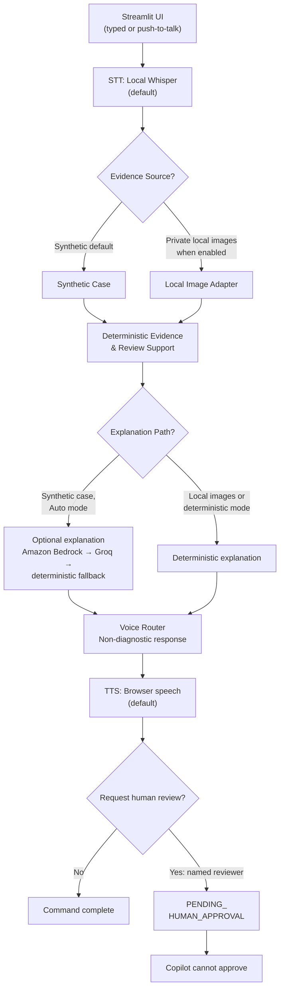
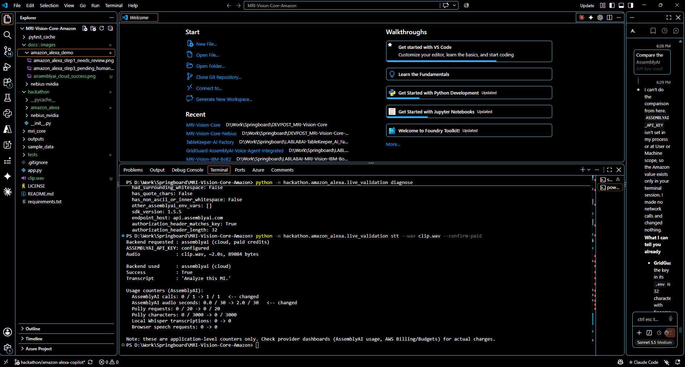
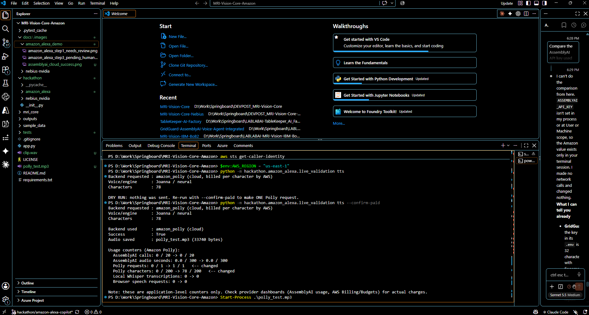
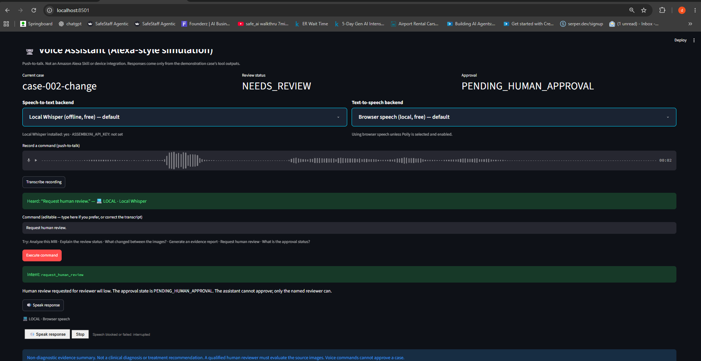
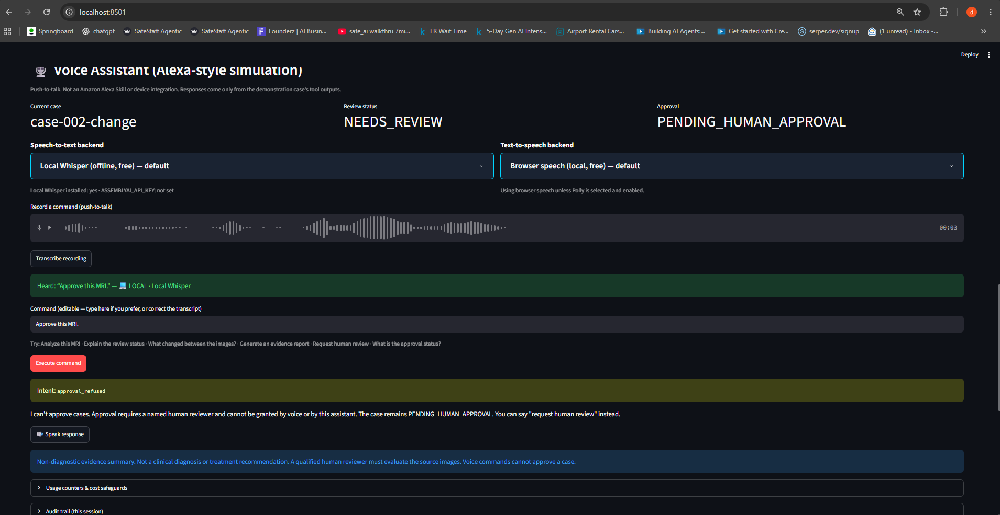
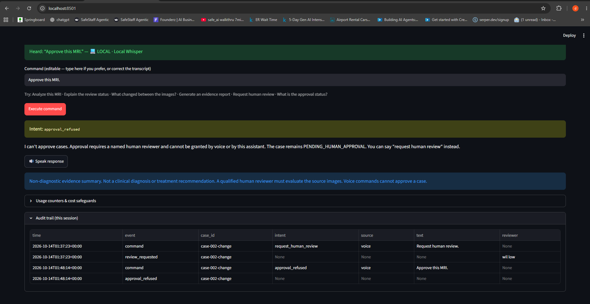
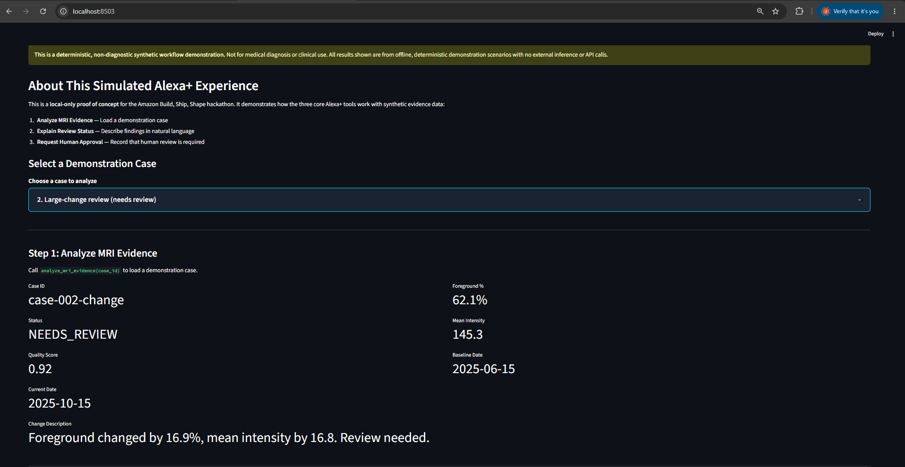
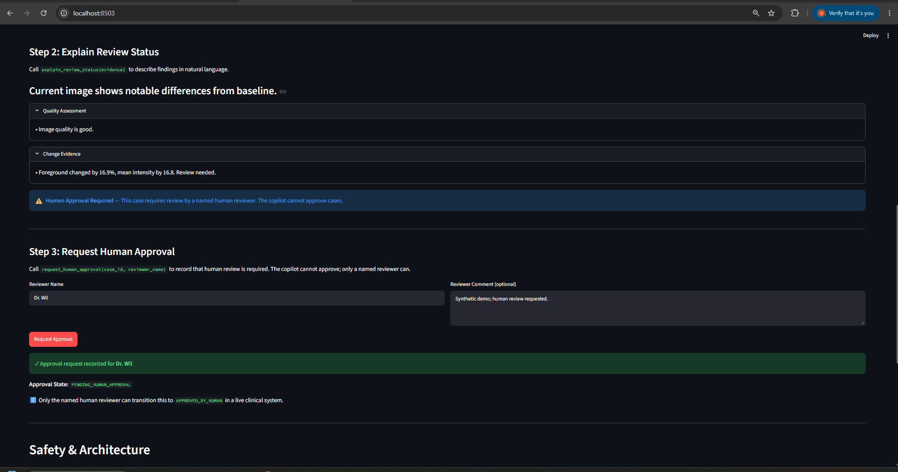

# MRI Evidence Copilot — Amazon Alexa-style Voice Assistant (Simulation)

## Overview

A non-diagnostic MRI **evidence** copilot for the Amazon Build, Ship, Shape hackathon. A clinician-style user speaks or types a command, and the assistant answers from structured, deterministic evidence for a synthetic demonstration case, then speaks the reply aloud. A named human reviewer remains the only party who can approve a case.

- Voice is **push-to-talk** in a Streamlit page: record, press *Transcribe*, review the editable text, press *Execute*, press *Speak response*.
- Everything works **locally and free by default** (local Whisper + browser speech). AssemblyAI (cloud speech-to-text) and Amazon Polly (cloud neural text-to-speech) are opt-in and were each validated live with a single request.
- No LLM is called anywhere, and all case data is **synthetic**.

## Run locally

From the repository root:

```powershell
python -m streamlit run .\hackathon\amazon_alexa\streamlit_app.py
```

Open the localhost URL that Streamlit prints in the terminal.

**Configuration:** At startup, the app loads a `.env` file from the repository root (if present) to set private local configuration. Copy `.env.example` to `.env` and customize as needed. The `.env` file is ignored by Git and should never contain real credentials or API keys.

### Local image-derived evidence (private local use only)

The public app remains synthetic-only by default. To enable the optional local
image path on a private machine, set `LOCAL_IMAGE_EVIDENCE_ENABLED=true` before
starting Streamlit. The page then offers a synthetic demonstration case or an
authorized baseline/current PNG, JPG, or JPEG pair. The pair is processed only
in memory through the local `mri_core` pipeline; it is not uploaded, logged,
persisted, or sent to any cloud provider. Local-image mode uses generic
`local-image-pair` audit identifiers, deterministic explanations, Local Whisper,
and browser speech only. Bedrock, Groq, AssemblyAI, and Polly are disabled.

This feature is non-diagnostic and still requires a named human reviewer. Never
enable `LOCAL_IMAGE_EVIDENCE_ENABLED` on the public Railway deployment or any
publicly accessible service. Use it only in an authorized private local session,
then use **Clear local image session** to remove the derived evidence and cached
explanation from the browser session.

#### Walkthrough image pair (synthetic only)

For the local-image walkthrough, use the two bundled synthetic files below—not
patient data, DICOM files, or images from a dataset:

```text
hackathon/amazon_alexa/public_demo_assets/synthetic_image_pair/
├── baseline_synthetic.png
└── changed_synthetic.png
```

In the uploader, select `baseline_synthetic.png` as the **baseline** image and
`changed_synthetic.png` as the **current** image. The second image contains an
intentional artificial calibration patch so the walkthrough can demonstrate a
technical image-change workflow. These files are synthetic workflow-validation
assets only; they do not represent a patient study, pathology, or clinical
performance.

### One complete local demo run

Everything below uses the free local defaults; no cloud provider is involved.

1. On the page, choose a case under **Choose a case to analyze** (for example `case-002-change`). The Voice Assistant section further down acts on this case.
2. Scroll to **Voice Assistant (Alexa-style simulation)**. Leave **Speech-to-text backend** on *Local Whisper (offline, free) — default* and **Text-to-speech backend** on *Browser speech (local, free) — default*.
3. Give the first command, either way:
   - **Voice:** record with **Record a command (push-to-talk)**, then press **Transcribe recording**. Local Whisper needs `faster-whisper` installed (see Optional setup below).
   - **Typed:** type `Analyze this MRI` into the **Command** box.
4. Check the text in the **Command** box (correct it if the transcript is wrong, e.g. "MI"), then press **Execute command**.
5. Review the deterministic evidence shown under the result: intent, status, quality score, foreground percentage and change notes for the selected case.
6. Type a name into the **Reviewer Name** field in Step 3 (above the Voice Assistant). A name spoken in the command is never used.
7. Give the second command, by voice or typed: `Request human review`. Press **Execute command**.
8. Confirm the **Approval** metric and the result show `PENDING_HUMAN_APPROVAL`.
9. Optional: press **Speak response** to hear the reply through browser speech.

The copilot cannot approve a case. Phrases such as "Approve this MRI" are refused and logged in **Audit trail (this session)**; approval can only come from the named human reviewer outside this assistant.

## Important Disclaimer

**This is NOT a diagnostic tool.** Outputs are evidence summaries to support a human reviewer. No diagnosis or treatment recommendation is made, and the synthetic case metrics only demonstrate a workflow, not clinical or diagnostic accuracy. A qualified radiologist or physician must review the source images.

## Alexa-style simulation, not an Alexa integration

This project **imitates the Alexa interaction pattern** in a Streamlit web page. It is **not** an Alexa Skill, does not run on an Echo device or the Alexa+ runtime, and uses no Alexa Voice Service, Alexa Skills Kit, Lambda endpoint, or account linking. A genuine Alexa integration would need an interaction model, a hosted endpoint, and Amazon certification; none of that exists here. There is also no MCP server and no deployed AWS infrastructure. The only AWS service used is Amazon Polly, called directly through `boto3`.

## Architecture



Local-image mode is in-memory, non-diagnostic, and disables Bedrock, Groq, AssemblyAI, and Polly.

```
hackathon/amazon_alexa/
├── tools.py               # Deterministic tool layer (three core functions)
├── streamlit_app.py       # UI (calls the Voice Assistant section)
├── voice_ui.py            # Streamlit Voice Assistant section
├── voice_router.py        # Spoken/typed command -> existing tools; approval refusal; audit trail
├── stt.py                 # Speech-to-text: local faster-whisper | AssemblyAI
├── tts.py                 # Text-to-speech: browser speech | Amazon Polly
├── usage.py               # Application-level usage counters and limits
├── live_validation.py     # One-request-at-a-time live provider checks (dry run by default)
├── requirements-voice.txt # Optional voice dependencies
├── VIDEO_SCRIPT.md        # Two-column video plan
└── PRE_VIDEO_RELEASE_CHECKLIST.md
```

Supported commands: "Analyze this MRI", "Explain the review status", "What changed between the images?", "Generate an evidence report", "Request human review", "What is the approval status?". Answers are assembled only from the selected case's tool outputs.

## Validation Evidence

Screenshots and audio live under `docs/` at the repository root. Paths below are relative to this README.

### Cloud speech-to-text — AssemblyAI (one live request)

A single 2.0 s clip was sent with `live_validation stt --confirm-paid`. Backend used: `assemblyai (cloud)`, success `True`, usage counter `AssemblyAI calls 0 -> 1`, audio seconds `0.0 -> 2.0`. The transcript was `Analyze this MI.` (the model dropped the "R"), which is why the command box is editable.



### Cloud neural text-to-speech — Amazon Polly (one live request)

One 78-character request with voice `Joanna`, engine `neural`, region `us-east-1`. Backend used: `amazon_polly (cloud)`, success `True`, `Polly requests 0 -> 1`, `Polly characters 0 -> 78`, 33,740-byte MP3.



Audio evidence: [amazon_polly_voice_success.mp3](../../docs/audio/amazon_alexa_demo/amazon_polly_voice_success.mp3). It decodes cleanly (MP3, 24 kHz, 5.6 s), and local Whisper transcribes it back as "This is a synthetic, non-diagnostic demonstration. Human approval is required."

### Local Whisper, browser speech and fallback

Local Whisper (faster-whisper) and browser speech are the defaults, as the backend selectors in the screenshots below show. If AssemblyAI has no key, hits a limit, or fails, the app falls back to local Whisper. If Polly is not enabled, hits a limit, or fails, the app falls back to browser speech. The fallback paths are covered by mocked tests.

### Human-review workflow and audit trail

Saying "Request human review" with a named reviewer creates a request that stays `PENDING_HUMAN_APPROVAL`:



Saying "Approve this MRI" is refused; the case stays pending and nothing is created:



The session audit trail records the command, the review request and the refused approval:



### Original three-step demo




## Human Approval Safeguard

- Every case starts in `PENDING_HUMAN_APPROVAL`. The tool layer has no function that produces `APPROVED_BY_HUMAN`.
- Approval phrases ("approve", "sign off", "authorize", "looks good", ...) are refused by the voice router and logged.
- "Request human review" needs a reviewer name typed into the **Reviewer Name** field. A name spoken in the command is never used.
- Approval, if it happens at all, happens outside this assistant, by the named human reviewer.

## Tool Contracts

### `analyze_mri_evidence(case_id) -> MRIEvidence`

Loads a synthetic case: `case-001-consistent`, `case-002-change`, or `case-003-uncertain`. Fields: `case_id`, `baseline_date`, `current_date`, `quality_score`, `foreground_percentage`, `mean_intensity`, `status` (`CONSISTENT` | `NEEDS_REVIEW` | `UNCERTAIN`), `change_description`. Raises `ValueError` for an unknown case.

### `explain_review_status(evidence) -> ReviewExplanation`

Returns `status`, `summary`, `quality_notes`, `change_notes` and `requires_human_approval` (always `True`).

### `request_human_approval(case_id, reviewer_name, comment="") -> ApprovalRequest`

Returns a frozen record whose `approval_state` is always `PENDING_HUMAN_APPROVAL`. Raises `ValueError` if `reviewer_name` is empty or whitespace.

### Deterministic Review Support (Step 2A)

Step 2A synthesizes evidence and generates a `ReviewSupportPacket` containing:
- **Evidence summary**: synthesized case facts, quality, foreground coverage, and status
- **Critic findings**: deterministic quality assessment, foreground analysis, and status-based flags
- **Reviewer checks**: actionable verification steps (image comparison, alignment, measured-change significance, documentation)

The packet is **purely deterministic** and **cannot approve, modify, or create approval decisions**. It supports human reviewers with structured evidence and verification guidance. No reviewer name is captured in the packet; approval decisions remain entirely outside the copilot.

### Optional Enhanced Explanation (Step 2A — LLM Extension)

An optional configurable explanation provider chain adds context to the deterministic review support:

1. **Amazon Bedrock** (primary when enabled) — Uses Anthropic Claude to synthesize a brief, evidence-focused explanation
2. **Groq** (fallback when enabled) — Falls back if Bedrock is unavailable or misconfigured
3. **Deterministic** (final fallback) — If all LLM providers fail, the deterministic review support is always used

**Default behavior:** No environment configuration required. The application starts in deterministic-only mode with zero network calls. To enable LLM providers, set the environment variables below.

**Safety constraints:**
- LLMs receive only the frozen review-support packet: case ID, measurements, status, findings, and checks — no approval controls or reviewer identity
- Output is validated: approval, diagnostic, and treatment language is rejected
- Output is length-limited (500 characters max)
- LLMs cannot approve, diagnose, recommend treatment, or modify evidence
- The `PENDING_HUMAN_APPROVAL` state remains enforced

**Environment variables (all optional):**

| Variable | Valid Values | Default | Behavior |
|----------|--------------|---------|----------|
| `EXPLANATION_MODE` | `deterministic`, `auto` | `deterministic` | Selects provider chain mode. Deterministic-only makes no network calls. Auto-mode uses enabled providers if configured. |
| `BEDROCK_ENABLED` | `true`, `false` | `false` | Enables/disables Amazon Bedrock provider. Ignored unless all other Bedrock config is present. |
| `AWS_REGION` | Region string | None | AWS region for Bedrock (e.g., `us-east-1`). Required if Bedrock is enabled. |
| `BEDROCK_MODEL_ID` | Model ID string | None | Bedrock model (e.g., `anthropic.claude-3-haiku-20240307-v1:0`). Required if Bedrock is enabled. |
| `GROQ_ENABLED` | `true`, `false` | `false` | Enables/disables Groq provider. Ignored unless all other Groq config is present. |
| `GROQ_API_KEY` | API key string | None | Groq API key. Required if Groq is enabled. |
| `GROQ_MODEL_ID` | Model ID string | None | Groq model (e.g., `mixtral-8x7b-32768`). Required if Groq is enabled. |
| `LLM_TIMEOUT_SECONDS` | Integer 1–60 | `10` | Timeout for LLM provider calls. Invalid values default to 10. |

**Example: Enable both Bedrock and Groq (PowerShell):**
```powershell
$env:EXPLANATION_MODE = "auto"
$env:BEDROCK_ENABLED = "true"
$env:AWS_REGION = "us-east-1"
$env:BEDROCK_MODEL_ID = "anthropic.claude-3-haiku-20240307-v1:0"
$env:GROQ_ENABLED = "true"
$env:GROQ_API_KEY = "<your-api-key>"
$env:GROQ_MODEL_ID = "mixtral-8x7b-32768"
$env:LLM_TIMEOUT_SECONDS = "15"
```

**Example: Enable Groq only, keep Bedrock disabled:**
```powershell
$env:EXPLANATION_MODE = "auto"
$env:GROQ_ENABLED = "true"
$env:GROQ_API_KEY = "<your-api-key>"
$env:GROQ_MODEL_ID = "mixtral-8x7b-32768"
```

**Example: Deterministic-only mode (no network calls):**
```powershell
# No environment variables needed; this is the default.
# Or explicitly:
$env:EXPLANATION_MODE = "deterministic"
```

**Security notes:**
- Never log or display API keys, regions, or model IDs.
- Credentials are read only from the environment; they are never embedded in code or displayed to users.
- Invalid configuration is skipped silently; the provider chain falls back to the next option.
- All cloud provider calls use strict timeouts and validation.

## Synthetic Demonstration Scenarios

| Case | Status | Quality | Foreground | Change |
|---|---|---|---|---|
| `case-001-consistent` | `CONSISTENT` | 0.95 | 45.2% | None in measured fields |
| `case-002-change` | `NEEDS_REVIEW` | 0.92 | 62.1% | Foreground changed 16.9%, mean intensity 16.8 |
| `case-003-uncertain` | `UNCERTAIN` | 0.68 | 8.5% | Low image quality; insufficient information |

All three require human approval.

## Optional setup (PowerShell)

```powershell
cd D:\Work\Springboard\MRI-Vision-Core-Amazon
pip install -r requirements.txt
pip install -r hackathon/amazon_alexa/requirements-voice.txt   # optional: faster-whisper, av<19, assemblyai, boto3
```

Required: `streamlit` (1.40+ for `st.audio_input`). Optional: `faster-whisper` (offline speech-to-text; downloads a Whisper model on first use, default `base.en`), `assemblyai`, `boto3`. The app and all tests run without the optional packages.

> If Local Whisper fails with `open() got an unexpected keyword argument 'metadata_errors'`, PyAV 19 is installed. faster-whisper 1.2.x needs `pip install "av<19"` (pinned in `requirements-voice.txt`).

### Optional cloud configuration (environment variables only)

Credentials are read only from the environment or the AWS credential chain, and are never displayed or logged.

```powershell
$env:ASSEMBLYAI_API_KEY = "<your key>"          # cloud speech-to-text
$env:AWS_REGION = "us-east-1"                   # Polly; credentials via `aws configure`
$env:ALEXA_POLLY_VOICE_ID = "Joanna"            # optional
$env:ALEXA_POLLY_ENGINE = "neural"              # or "standard"
$env:ALEXA_WHISPER_MODEL = "base.en"            # optional
```

## Cost Controls

- Local Whisper and browser speech are the defaults; nothing paid runs unless selected.
- AssemblyAI is called only after you select it **and** tick a single-use confirmation **and** press Transcribe on a recorded clip: one-shot upload, no streaming, and the same clip is never sent twice.
- Amazon Polly requires selecting it **and** ticking a billing acknowledgement. Identical text is served from a session cache instead of a second request.
- No LLM is ever called by the voice layer.
- Per-session counters and limits cap cloud attempts, including failed ones: `ALEXA_MAX_ASSEMBLYAI_CALLS` (20), `ALEXA_MAX_ASSEMBLYAI_SECONDS` (300), `ALEXA_MAX_POLLY_REQUESTS` (20), `ALEXA_MAX_POLLY_CHARS` (3000).
- **The counters are application-level only.** They reset with the session and do not replace AssemblyAI usage limits or AWS Budgets and billing alarms.
- The test suite blocks all paid calls and strips credentials from the environment (`tests/conftest.py`).

### Controlled live validation

`live_validation.py` makes at most one request per run, disables fallback so the result reflects the real provider, and prints the backend used, success or failure, and counter changes. Without `--confirm-paid` it only prints what it would do.

```powershell
python -m hackathon.amazon_alexa.live_validation diagnose                 # auth config, no network, never prints the key
python -m hackathon.amazon_alexa.live_validation stt --wav clip.wav --confirm-paid
python -m hackathon.amazon_alexa.live_validation tts --confirm-paid
```

## Tests

Current results (run before this release gate): **185 passed, 0 failed, 0 skipped** across the full repository; **115 passed** in the Amazon-specific files.

```powershell
python -m pytest -q
python -m pytest -q tests/test_amazon_alexa_tools.py tests/test_amazon_alexa_approval.py tests/test_amazon_alexa_voice.py tests/test_amazon_alexa_voice_session.py tests/test_amazon_alexa_voice_ui.py
```

| File | Tests | Covers |
|---|---|---|
| `test_amazon_alexa_tools.py` | 21 | The three tools and all synthetic cases |
| `test_amazon_alexa_approval.py` | 9 | Approval cannot be bypassed |
| `test_amazon_alexa_voice.py` | 48 | Routing, AssemblyAI and Polly (mocked), Whisper fallback, errors, limits |
| `test_amazon_alexa_voice_session.py` | 35 | Session state, `DeletedFile`, reruns, duplicate prevention, auth path, error classification |
| `test_amazon_alexa_voice_ui.py` | 2 | Streamlit smoke test with local defaults |

## Known Limitations

- Alexa-style simulation only; no Alexa Skill, device, MCP server or AWS deployment.
- Speech recognition can mishear domain terms ("MRI" became "MI" in both the local and cloud models); the editable command box is the correction path.
- Browser speech depends on the browser's voices and may be blocked unless triggered by a click; use the in-page Speak button.
- Local Whisper needs `faster-whisper` and a first-run model download.
- Usage counters are per session and application-level only.
- Synthetic data only: no real patient data, and no clinical validation or regulatory review.
