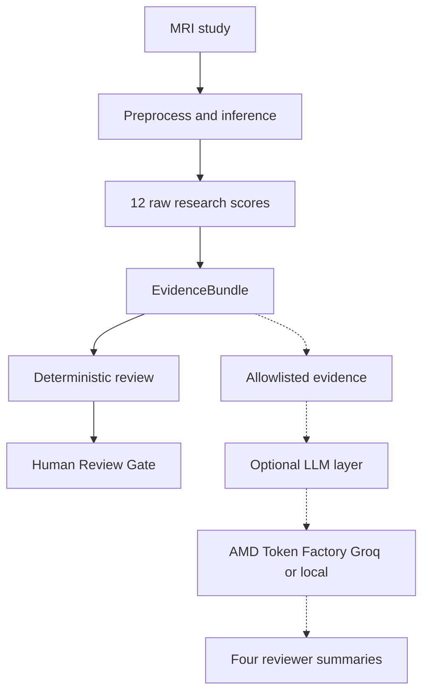
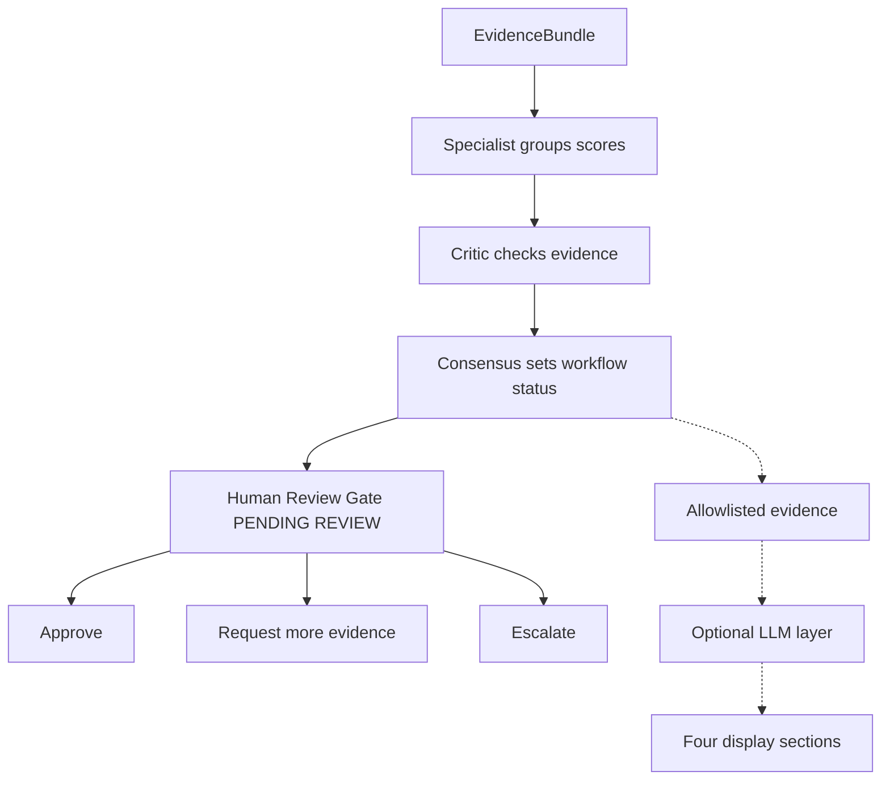
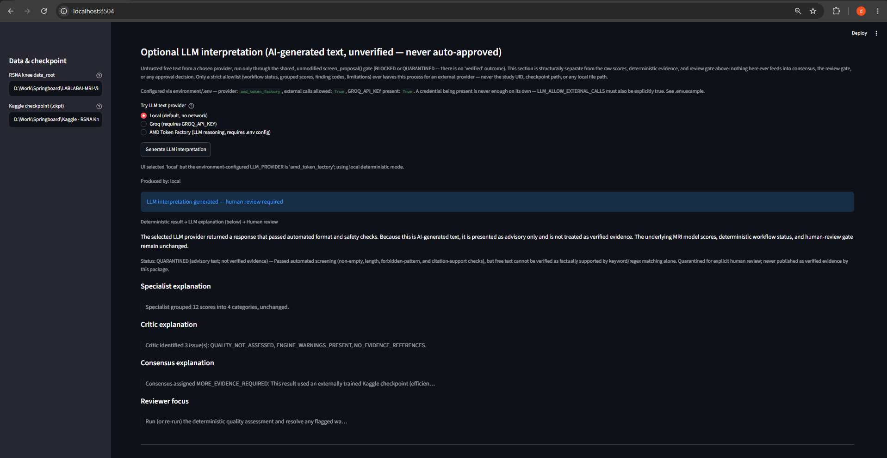

# MRI-Vision-Core — AMD AI Review Workflow

A research/demo MRI AI workflow: trained MRI inference on a real DICOM study, deterministic
multi-stage evidence review, an optional LLM-assisted plain-language explanation, reproducible
benchmarking across 22 curated studies, and an explicit human-approval gate that no automated
layer can bypass.

> **Research/demo benchmark only; not clinical accuracy or medical performance.** Every score
> below is a raw, uncalibrated sigmoid output — never a diagnosis or a confidence score.

## System architecture

The workflow separates trained MRI inference, deterministic evidence review, optional
LLM-assisted explanation, and explicit human authorization. The diagram below shows how those
components interact.



The dotted path is advisory only: the LLM provider never changes the 12 model scores, never
changes the deterministic Consensus workflow status, and never submits an approval to the Human
Review Gate — it only reads allowlisted evidence and returns text for a reviewer to read.

## How the review agents work together



Only a named human, acting on the Human Review Gate directly, can Approve, Request more
evidence, or Escalate — the optional LLM layer is a separate, display-only advisory path: it
never changes the Consensus workflow status and never submits an approval or any other decision
to the gate on a human's behalf.

The following Streamlit view is implementation evidence: it renders the structured
reviewer-facing sections while the deterministic workflow and human-review state remain
unchanged.



Specialist, Critic, and Consensus are deterministic, pure functions over one `EvidenceBundle`;
an orchestrator runs them in sequence, each passing its output to the next.

### Specialist
Groups the 12 raw model scores into four fixed categories (Ligaments, Menisci, Osteoarthritis,
Other), restating each score verbatim — no ranking, interpretation, or positive/negative decision.

### Critic
Runs fixed structural checks: label order and value range, finite probabilities, checkpoint
provenance, model-count/ensemble consistency, and whether the quality gate has been run. A
passing check is not a safety signal.

### Consensus
Uses the Critic's findings plus the bundle's own inference/quality state — not the Specialist's
output — to produce one workflow status (e.g. `MORE_EVIDENCE_REQUIRED`,
`EVIDENCE_COMPLETE_FOR_RESEARCH_REVIEW`). Decision support only; it never approves anything and
always initializes a fresh review in a pending state.

### Human Review Gate
Required for every result, which always starts `PENDING_REVIEW`. Only a named human action —
**Approve**, **Request more evidence**, or **Escalate**, each with a required reason — can change
state, through `mri_core.agents.review_gate.ReviewGate` (shared, unmodified). There is no agent
auto-approval path, and the audit trail is append-only.

### Optional LLM explanation
An optional provider (AMD Token Factory, Groq, or a local deterministic fallback) turns the
structured evidence above into a concise, reviewer-facing explanation. Only a strict allowlist of
already-deterministic fields is ever sent externally — never the study UID, checkpoint path, or
any local file path — and the output is screened to **BLOCKED** or **QUARANTINED** only; nothing
it produces is read by the review-gate code.

## Reproducible 22-study benchmark

A runner (`scripts/run_amd_benchmark.py`) walks all 22 curated RSNA MRI scenarios, checks each
one's underlying study against the locally configured data root, and runs real inference only
where the study is actually present — never fabricating a result for a missing study.

**Latest measured run, all 22 studies available locally:**

| Metric | Value |
|---|---|
| Curated scenarios | 22 |
| Successfully inferred | 22/22 |
| Inference coverage | 100% |
| Failures | 0 |
| Macro ROC-AUC | 0.599 |
| Macro PR-AUC | 0.485 |
| Mean latency | 0.987 s |
| Median latency | 0.961 s |
| Total inference wall time | 21.723 s |

Per-target ROC-AUC, reported honestly rather than hidden — this checkpoint separates some
findings well and others not at all:

| Stronger | ROC-AUC | Weaker | ROC-AUC |
|---|---|---|---|
| Synovitis | 0.752 | PF OA | 0.324 |
| Medial OA | 0.736 | ACL | 0.419 |
| Fracture | 0.695 | MCL | 0.458 |
| Lateral Meniscus | 0.671 | | |
| Baker's | 0.667 | | |

The benchmark scores against the RSNA competition's own **competition reference labels** — not a
diagnosis — and every probability is a raw, uncalibrated sigmoid output. This is a research
evaluation of one specific bridged checkpoint, not clinical validation, and not a statement about
the underlying clinical task in general.

Full results: [`amd_benchmark_latest.md`](../../benchmarks/amd/results/amd_benchmark_latest.md) ·
[`amd_benchmark_latest.json`](../../benchmarks/amd/results/amd_benchmark_latest.json)

```bash
python scripts/run_amd_benchmark.py --dry-run   # check local availability only, no inference
python scripts/run_amd_benchmark.py             # run real inference where available
```

## LLM provider layer

This is a provider/integration layer, not a second predictive benchmark — the LLM only produces
an optional explanation of evidence the deterministic layers above already computed.

| Provider | Integration | Live validation | Role |
|---|---|---|---|
| **AMD Token Factory** | Real network client (chat-completions, OpenAI-compatible, strict JSON-schema response validation) | Live integration validated with 5/5 successful HTTP 200 calls using synthetic, non-medical structured evidence. Responses matched the expected structured schema and continued through the existing screening and human-review safeguards. | Optional reviewer-facing explanation |
| **Groq** | Real network client, same redaction/screening path | A real API key was tested against this endpoint during development (the default model in the adapter was chosen after a different one 404'd for that key). | Optional reviewer-facing explanation |
| **Local (default)** | Deterministic template, no network call, no credential | Always available; covered directly by the test suite | Default, and the automatic fallback whenever an external provider is unavailable or not allowed |

Providers are interchangeable by design: the MRI inference and the deterministic Specialist/
Critic/Consensus/Human-Review-Gate logic never change when the LLM provider changes — only which
text fills the optional explanation panel does.

## Running it locally

```bash
pip install -r requirements-amd.txt
cp .env.example .env    # optional — LLM provider config
streamlit run hackathon/amd/streamlit_app.py
```

Real MRI inference needs a local RSNA knee `data_root` and a bridged checkpoint (`AMD_KAGGLE_RSNA_ROOT`
/ `AMD_KAGGLE_CHECKPOINT`, environment or `.env`). The deployed application does **not** bundle any
raw DICOM data or model weights — without those configured, a synthetic workflow demonstration
panel still exercises the full evidence-review/human-review/LLM pipeline with fixed, clearly
labeled placeholder values.

## Limitations

- Benchmarked against 22 curated studies, not the full competition dataset.
- Model outputs are raw, uncalibrated probabilities — not clinical confidence scores.
- The checkpoint was trained externally and bridged into this app, not trained here.
- The 22-study benchmark is a research evaluation, not clinical validation.
- All measured inference and benchmarking has been CPU-only; no AMD GPU acceleration has been
  exercised in this project.
- The optional LLM explanation is a text-generation convenience, not a diagnostic component.

## Result

Built a reproducible MRI AI evaluation pipeline across 22 real studies: 22/22 successful
inference runs, 0 failures, macro ROC-AUC 0.599, macro PR-AUC 0.485, and a 0.987-second mean
inference latency — evaluated against competition reference labels, not diagnoses.

*Research/demo benchmark only; not clinical accuracy or medical performance.*
