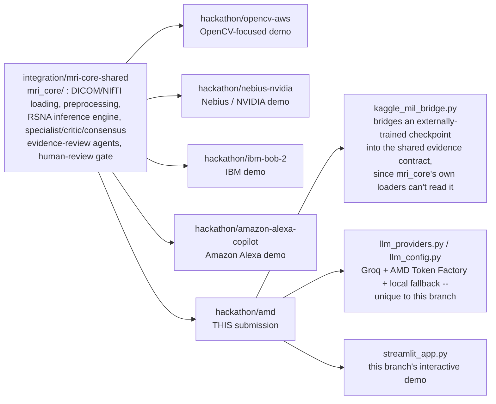
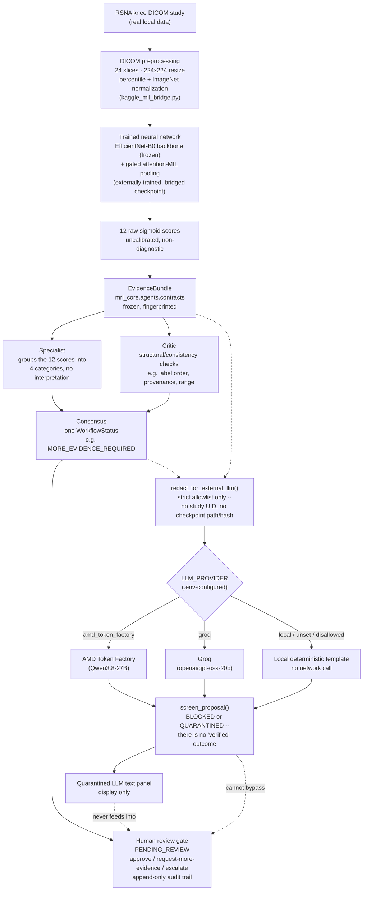

# MRI-Vision-Core — AMD hackathon submission

> **Research prototype. Not a diagnostic device.** Every score below is a raw, uncalibrated
> sigmoid output. Nothing in this project is a clinical finding, a diagnosis, or a confidence
> score, and no part of it is validated for clinical use.

This document is written for someone who has never seen MRI-Vision-Core before. If you only
read one section, read "What this AMD submission demonstrates" and look at Diagram B.

## MRI-Vision-Core, the project

MRI-Vision-Core started as a Python/OpenCV MRI exploration tool (loading DICOM/NIfTI studies,
preprocessing, segmentation) and grew a shared, reusable core — `mri_core/` — that several
independent hackathon submissions now build on top of, each demonstrating something different
with the *same* underlying inference engine and evidence-review infrastructure rather than
reimplementing it per hackathon. That shared code lives on `integration/mri-core-shared` and is
reused, never modified, by each hackathon branch.



Every hackathon branch reuses `mri_core/` as-is; none of them modify it. What differs is which
capability each branch chooses to demonstrate on top of it.

## What this AMD submission demonstrates

Four things, each real, each independently verifiable:

1. **Trained MRI inference** on a real local DICOM study, through a real externally-trained
   checkpoint, bridged into the shared pipeline (see "The data and the model" below).
2. **Deterministic specialist/critic/consensus evidence review** — the *same*, unmodified
   shared code every other hackathon branch uses, applied here to the bridged result.
3. **AMD Token Factory-assisted interpretation** (with Groq as an alternative, and a local,
   network-free fallback) — optional, explicitly gated, and never trusted automatically.
4. **Simulated human oversight** — an audited approve/request-more-evidence/escalate workflow
   that no AI output, however well-formed, can bypass.

What this submission does **not** demonstrate: no AMD GPU acceleration has been run anywhere in
this project (every inference and benchmark run so far has been CPU-only); no training happens
in this adapter; no accuracy/validation metric for the bridged checkpoint has been independently
verified here (see below for exactly why, and what *is* verified).

## The data and the model

**Data source:** the [RSNA Knee Abnormality Detection](https://www.kaggle.com/) Kaggle
competition's knee MRI DICOM studies. Locally, a `data_root` directory holds `train.csv` /
`train_series.csv` (study- and series-level metadata — plane, fluid-sensitivity, the 12 target
labels) plus `raw/train_series/<StudyInstanceUID>/<SeriesInstanceUID>/*.dcm` (the actual DICOM
slice files). None of this data, and no model checkpoint, is committed to this repository —
both are gitignored and supplied locally (see "Running it yourself").

**What was trained, and where:** a `timm` `efficientnet_b0` backbone (ImageNet-pretrained,
**frozen**) feeding a trainable **gated attention-MIL pooling** head (Ilse et al.'s
attention-based multiple-instance-learning formulation) and a linear layer producing **12
logits** — one per target (`ACL, MCL, Medial Meniscus, Lateral Meniscus, Medial OA, Lateral OA,
PF OA, Effusion, Synovitis, Baker's, Contusion, Fracture`). Only the pooling+head (~343K
parameters) was ever trained; the backbone's ImageNet weights were never fine-tuned. Training
happened in an **external Kaggle notebook** (`kneeabdet-baseline-v1`, PyTorch Lightning,
5-fold stratified cross-validation) on **at most 58 fully gold-labeled studies (46-48 per
fold)** — not inside this repository, and not by this adapter, which performs no training at
all.

**Why attention-MIL, not a single-image CNN:** a knee MRI series is 20-30 slices, and an
abnormality (e.g. an ACL tear) is visible on only a handful of them. Attention-MIL lets the
model learn *which* slices matter for each study, rather than averaging over all of them (which
dilutes a lesion visible on 2 slices out of 24) or picking one slice heuristically.

**No accuracy/AUC claim is made for this checkpoint.** Nothing in this project has
independently re-evaluated it against held-out labels; the only properties verified here are
structural — it loads, it produces 12 well-formed probabilities in `[0, 1]`, and it is
reproducible bit-for-bit across repeated runs on the same input. (A *different* experimental
architecture — "Model C0," documented separately on another branch — does have published
weak-label AUC diagnostics; that is a different model, trained on different data, and is not
used here — see "Validation evidence and limitations.")

**24-slice preprocessing** (must match the original training notebook exactly, or the sigmoid
outputs are meaningless): 24 slices sampled at evenly spaced indices through the series, each
decoded and resized to 224×224, then 1st/99th-percentile intensity normalization per study
(fixes cross-scanner intensity scale), then single-channel standardization using the three
ImageNet channel statistics averaged into one (mean 0.449, std 0.226, since the pretrained
backbone expects zero-mean/unit-std input and the MRI is single-channel, not RGB).

**The Kaggle checkpoint compatibility bridge:** the shared `mri_core` pipeline's own model
(`RSNAKneeCNN`, an MRNet-style multi-plane encoder) is architecturally unrelated to this
checkpoint — different backbone, different pooling, different state-dict keys entirely.
`mri_core`'s own loaders cannot read this checkpoint, and no checkpoint compatible with
`RSNAKneeCNN` exists anywhere on the machines this project has been developed on.
`hackathon/amd/kaggle_mil_bridge.py` is a minimal, **inference-only** reimplementation of the
Kaggle architecture (not a modification of `mri_core`) so these real external weights can
actually be run; `hackathon/amd/agent_bridge_adapter.py` then adapts its output into the shared
`StudyInferenceResult` type so every downstream evidence-review module works completely
unmodified on a bridged result (see Diagram B).

## Diagram B — the full AMD workflow



**The dotted lines are the point of this diagram.** The LLM branch (bottom half) reads the same
evidence the human reviewer sees, but nothing it produces — however well-formed, however
plausible — ever reaches `REVIEW`. The human-review gate only ever changes state because a
named human clicked a button with a reason attached.

## Evidence review: what specialist, critic, and consensus each do

All three are shared, unmodified `mri_core.agents` code — every hackathon branch gets the
identical guarantees.

| Layer | Responsibility | Never does |
|---|---|---|
| **Specialist** | Groups the 12 raw scores into 4 categories (Ligaments, Menisci, Osteoarthritis, Other) for readability | Interpret, round, or recompute any value |
| **Critic** | Runs deterministic structural checks — label order matches the 12 targets, every probability is finite and in `[0, 1]`, checkpoint provenance is present, the engine's own status/probability fields agree with each other | Certify anything as "safe"; a passing check is not a safety signal |
| **Consensus** | Applies a documented, fixed rule order to produce exactly one `WorkflowStatus` (e.g. `MORE_EVIDENCE_REQUIRED`, `EVIDENCE_COMPLETE_FOR_RESEARCH_REVIEW`, `INCONSISTENT_EVIDENCE`) | Average opinions into a score, or invent a status not in that fixed list |

For a bridged run, consensus will — correctly, every time — report `MORE_EVIDENCE_REQUIRED`:
the deterministic image-quality gate (`mri_core.decision`) has never been run against this
bridge's own preprocessing, so `quality_gate_status` stays `NOT_ASSESSED`, which the consensus
rules treat as incomplete evidence. This is intentional honesty, not a bug.

## Optional AI-assisted interpretation

A second, independent, optional layer: ask an LLM to restate the deterministic evidence above
in plain language. It is **never required**, **never trusted automatically**, and **never
able to influence the human-review decision** — see the dotted lines in Diagram B.

**Why LLM text cannot change an approval decision, structurally, not by convention:**
- The LLM only ever sees a strict allowlist (`redact_for_external_llm()`): workflow status,
  grouped scores, structural finding codes, quality-gate status, limitations. It never
  receives the study UID, checkpoint path/hash, or any file path.
- Its output (`RawProposal`) is always run through the shared, unmodified
  `screen_proposal()`, which can only return **BLOCKED** (an automated check failed — a
  diagnosis-shaped claim, an invented approval phrase, an unsupported citation, excess length)
  or **QUARANTINED** (passed every automated check, but still unverified free text). There is
  no third outcome, and no function anywhere promotes a `QUARANTINED` result to trusted
  evidence.
- `hackathon/amd/review_actions.py` and `mri_core.agents.review_gate.ReviewGate` — the actual
  human-approval code — never read an LLM adapter's output at all. The two code paths don't
  share any state; a bug in one cannot leak into the other because there is no connection.

**Providers:**

| Provider | Model | Status |
|---|---|---|
| **AMD Token Factory** | `Qwen3.8-27B` | **Implemented and live-verified**, twice, with synthetic non-medical data only (see below) |
| **Groq** | `openai/gpt-oss-20b` (configurable) | **Implemented and live-verified** once, synthetic data only |
| **Local (default)** | none — a fixed deterministic template | Always available; no network call, no credential |

**Configuration is `.env`/environment-driven, not code** (see `.env.example`). The hard safety
rule: `LLM_ALLOW_EXTERNAL_CALLS` must be explicitly `true`, *in addition to* `LLM_PROVIDER`
naming that provider and its credentials all being present — an ambient API key sitting in the
environment is never, by itself, enough to authorize a live call (this was a real incident
during development; it is now a permanent regression test). A failed external-provider call
never automatically tries another external provider — only the local, network-free fallback.

**Live verification record** (both syntheic-data-only, non-medical, each exactly once per the
scope authorized at the time):
- **AMD Token Factory**: `POST {base_url}/chat/completions`, model `Qwen3.8-27B` — HTTP 200 in
  4.331s (isolated connectivity check) and again in 18.14s (full pipeline check: real
  `redact_for_external_llm()` → `propose()` → `screen_proposal()`, confirmed no identifying
  data transmitted, human-review state unchanged). The second call returned **BLOCKED** — a
  619-character response exceeded the shared 500-character proposal-length cap, and
  `screen_proposal()` correctly rejected it. Fix applied: the shared prompt now asks for one
  sentence under 350 characters, and the adapter itself now enforces that same 500-character
  cap (imported from `mri_core.agents.llm_adapter.MAX_PROPOSAL_LENGTH`, not a separate number)
  *before* a response ever reaches `screen_proposal()` — that shared gate itself was never
  touched, loosened, or bypassed.
- **Groq**: HTTP 200 in 1.848s, valid structured JSON, model `openai/gpt-oss-20b`.
- A caveat worth stating plainly: no official AMD documentation for the "Token Factory" REST
  contract used above was ever found during development — the publicly documented "Token
  Factory" API belongs to a different company (Nebius). The two successful live calls above are
  the only evidence this specific base URL/contract is real; treat it as account-specific.
- Every other failure mode (missing/invalid credentials, timeout, rate limit, malformed
  response, oversized response, unsafe-claim text, connection error) is covered by **79
  mocked tests** in `tests/test_amd_llm_providers.py` — re-runnable anytime, with no network
  call and no live API spend.

## Human review and the audit trail

A real, append-only state machine (`mri_core.agents.review_gate.ReviewGate`, unmodified),
scoped to one evidence fingerprint. States: `PENDING_REVIEW` → `MORE_EVIDENCE_REQUESTED` or
`REVIEWED` (terminal in this simulation — no reopening). Every transition requires a named
`actor` and a non-empty `reason`; both are validated before the transition is even attempted.

The shared gate has no separate "escalated" state, and adding one to shared `mri_core` code was
out of scope for this branch, so `hackathon/amd/review_actions.py`'s `escalate()` transitions to
the same `REVIEWED` state `approve()` uses, but always with the audit `reason` prefixed
`"ESCALATED: "` — visibly distinguishable in the history table, never silently merged with a
plain approval.

**No clinician approval is implied by any state here.** This is a simulated workflow-audit
demonstration, not a certified medical review process.

## The Streamlit UI, control by control

Launch with `streamlit run hackathon/amd/streamlit_app.py` (see "Running it yourself").

### Sidebar

| Control | Key | Purpose |
|---|---|---|
| "RSNA knee data_root" text input | `data_root_input` | Path to a real local directory with `train.csv` and `raw/train_series/...`. Prefilled from `AMD_KAGGLE_RSNA_ROOT` (env or `.env`); editable freely. Works with Windows (`D:\...`) or Linux (`/app/...`) paths. |
| "Kaggle checkpoint (.ckpt)" text input | `checkpoint_input` | Path to a real `foldN-knee-mil-best.ckpt` file. Prefilled from `AMD_KAGGLE_CHECKPOINT`. |
| **"Execution provider (hardware, not AI text)"** section | — | Where the model's forward pass would run — unrelated to the AI-text section further down. |
| "Enable AMD Token Factory hardware execution (optional, not implemented)" checkbox | `amd_enabled_checkbox` | **Status display only.** There is no real client behind this; checking it never dispatches anything to AMD hardware. Shown unchecked and disabled-by-default. |
| "Try LLM text provider" radio | `llm_provider_choice` | Which AI-text provider to *attempt*. Only takes effect if it matches the environment-configured `LLM_PROVIDER` **and** `LLM_ALLOW_EXTERNAL_CALLS=true`; otherwise it transparently falls back to local, and says so. |

If either data_root or checkpoint is empty, or fails a cheap validation check (directory/file
existence, `.ckpt` extension, `train.csv` presence — never a full dataset/checkpoint load just
to validate the sidebar), the app shows a specific error and stops; it never guesses a path or
fabricates a result.

### Main area, in the order they appear

0. **"🧪 Synthetic workflow demonstration" expander** — always present, regardless of whether
   real data/checkpoint are configured. "Run synthetic workflow demonstration" button
   (`synthetic_demo_button`) builds a fixed, fabricated placeholder result and runs it through
   the *same* evidence-review/human-review/LLM panels described below (widget keys prefixed
   `synthetic_...`), unmistakably labeled throughout as synthetic. This is what makes the app
   usable on Railway before any real dataset/checkpoint decision is made (see "Railway
   deployment readiness").
1. **Study selector** (`study_select`) — every fully-downloaded, labeled study found under
   `data_root`.
2. **"Run trained inference on this study"** button (`run_inference_button`) — loads the
   checkpoint (cached for the session), decodes the real DICOM series, runs the real forward
   pass, builds the evidence pipeline's input, and stores the result for the rest of the page.
3. **Scores panel** — the 12 raw probabilities, as a bar chart and a table, directly under the
   non-diagnostic disclaimer and any bridge-specific warnings (always shown, never collapsed).
4. **Checkpoint provenance panel** — SHA-256, architecture string ("bridged, not native"),
   Lightning epoch/step.
5. **Evidence review panel** — specialist groups, critic findings, consensus workflow status
   and required next steps (see table above).
6. **Human review gate panel** — current state; "Your name/role (actor)" (`real_actor_input`)
   and "Reason for this action" (`real_reason_input`) text fields; **Approve** / **Request more
   evidence** / **Escalate** buttons (`real_approve_button` / `real_request_more_evidence_button`
   / `real_escalate_button`), each disabled once the gate reaches `REVIEWED`. A reason is
   required — clicking without one shows an error and records nothing. The audit history table
   below updates immediately and is append-only. (This whole panel, and the two below it, are
   rendered by one shared function, `render_workflow()`, reused identically — down to the exact
   same code, not just the same look — by the synthetic demo above, with a `synthetic_` key
   prefix instead of `real_` so the two never collide on the same page.)
7. **"Optional LLM interpretation (AI-generated text, unverified — never auto-approved)"
   panel** — a caption showing the resolved `.env`/environment configuration (provider,
   whether external calls are allowed, whether a credential is present — never the credential
   itself); the provider radio described above (`real_llm_provider_choice`); **"Generate LLM
   interpretation"** button (`real_llm_generate_button`) — shows which provider actually
   produced the result (local fallback is reported honestly when that's what happened) and the
   `screen_proposal()` outcome (BLOCKED in red, or QUARANTINED in yellow with the quoted text).
8. **CPU benchmark evidence panel** — "Benchmark result file" path input
   (`benchmark_path_input`, defaults to `outputs/amd/benchmark_kaggle_bridge.json`); if that
   file exists, shows real CPU latency/throughput and the checkpoint's SHA-256; the GPU line
   always says "not available" honestly unless a real benchmark run on real AMD hardware
   produced that file — the app only displays a file, it never runs the benchmark itself.

## Running it yourself

```bash
pip install -r requirements-rsna.txt timm pydicom requests psutil
cp .env.example .env    # optional -- see "Optional AI-assisted interpretation" above
```

Set (environment or `.env`): `AMD_KAGGLE_RSNA_ROOT=<real data_root>`,
`AMD_KAGGLE_CHECKPOINT=<real foldN-knee-mil-best.ckpt>` — or leave both blank and type them
into the sidebar. Then:

```bash
streamlit run hackathon/amd/streamlit_app.py
```

With no `.env` and no environment variables at all, the optional LLM section runs entirely
local, with no network call and no credential required.

## Reproducible 22-scenario benchmark

A reproducible runner (`scripts/run_amd_benchmark.py`, implemented in
`hackathon/amd/benchmark_runner.py`) walks all **22 curated RSNA MRI scenarios**
(`benchmarks/amd/amd_demo_scenarios.json` — the same set the Streamlit app's "Curated MRI
Benchmark Scenarios" selector uses) and, for each one, checks whether its underlying study is
present under the configured `data_root` before running anything. A scenario whose study is not
available locally is recorded as unavailable and **never assigned a fabricated prediction**; a
scenario that fails during inference is recorded as a failure and the run continues with the
rest. Metrics are computed only over scenarios that were actually, successfully inferred.

```bash
python scripts/run_amd_benchmark.py --dry-run   # check local availability only, no inference
python scripts/run_amd_benchmark.py             # run real inference where the study is available
```

Full results: [`benchmarks/amd/results/amd_benchmark_latest.md`](../../benchmarks/amd/results/amd_benchmark_latest.md)
(README-ready) and [`amd_benchmark_latest.json`](../../benchmarks/amd/results/amd_benchmark_latest.json)
(machine-readable; per-scenario results, per-target metrics, checkpoint/environment provenance).

**Latest run on this machine, with all 22 underlying studies present locally:**

- 22/22 scenarios available locally, **22/22 successfully inferred**, 0 unavailable, 0 failed
  (**100% inference coverage**)
- Macro ROC-AUC: **0.599** · Macro PR-AUC: **0.485** (12 valid targets each)
- Mean latency: **0.987s** · Median latency: **0.961s** · Total wall time: **21.723s**

Per-target ROC-AUC, honestly reported — some targets separate well, several do not:

| Stronger | ROC-AUC | | Weaker | ROC-AUC |
|---|---|---|---|---|
| Synovitis | 0.752 | | PF OA | 0.324 |
| Medial OA | 0.736 | | ACL | 0.419 |
| Fracture | 0.695 | | MCL | 0.458 |
| Lateral Meniscus | 0.671 | | | |
| Baker's | 0.667 | | | |

These are research benchmark results for the specific externally trained checkpoint currently
bridged into this app (see "The data and the model" above) — not a statement about the
underlying clinical task in general, and not a result for any other model or checkpoint.
Probabilities are raw, uncalibrated sigmoid outputs; this benchmark is not clinical validation.
When fewer studies are available locally, the runner explicitly reports a metric as **not
computable** or **insufficient local sample size** with the reason, rather than printing a
number computed from too few examples (see the runner's own gating logic and
`tests/test_amd_benchmark_runner.py`).

*Research/demo benchmark only; not clinical accuracy or medical performance.*

## Validation evidence and limitations — the honest summary

- **Real, verified today:** local CPU inference through the bridged checkpoint on a real DICOM
  study (reproducible bit-for-bit); the full evidence-review pipeline on that result; the human
  review-gate state machine and its audit trail; Groq and AMD Token Factory connectivity
  (synthetic data, each live-verified); a reproducible automated benchmark across all 22
  curated scenarios (see "Reproducible 22-scenario benchmark" above); 79+28+… mocked
  failure-mode tests (see "Tests" below).
- **Not yet done:** no checkpoint compatible with the shared pipeline's *native* architecture
  (`RSNAKneeCNN`) exists anywhere this project has been developed, so that path has never
  produced a real-checkpoint prediction. No AMD GPU has been available anywhere in this
  project's development — every benchmark and inference run so far is CPU-only;
  `hackathon/amd/rocm_env.py` has only ever reported `amd_gpu_available: false`.
- **Unconfirmed, flagged rather than hidden:** no official AMD documentation for the "Token
  Factory" REST contract this adapter calls was ever found; its only evidence of legitimacy is
  the two successful live calls on this account. The AMD Token Factory *execution* provider
  (running the model itself on AMD hardware) remains a pure status seam — not the same thing as
  the AMD Token Factory *LLM reasoning* path above, which works.
- **A separate experimental architecture** ("Model C0," documented on another branch's Phase 15
  diagnostics) has its own weak-label AUC numbers against automated labels — not clinical
  accuracy, not this checkpoint, and not integrated here. See that branch's own documentation,
  not this one, for those numbers.

## Railway deployment readiness

**Not deployed yet** — this is a readiness assessment and the configuration files it needs,
not a deployment.

### What now exists in this repository for Railway

| File | Purpose |
|---|---|
| `requirements-amd.txt` | Every dependency this app actually imports (directly and transitively — see below), bounded to versions verified in this session. |
| `Procfile` | `web: streamlit run hackathon/amd/streamlit_app.py --server.port ${PORT} --server.address 0.0.0.0 --server.headless true` — binds to Railway's injected `$PORT`. |
| `.python-version` | Pins the Python runtime to `3.12`, matching what this app was built and tested against. |
| `hackathon/amd/synthetic_demo.py` | The synthetic workflow demonstration (see next section) — makes the app fully runnable on Railway **before** any real dataset/checkpoint is bundled. |

**Dependencies actually required to import and run this app** (not fully captured by any single
pre-existing `requirements*.txt` — now consolidated into `requirements-amd.txt` above):
`streamlit`, `torch` (CPU build), `pandas`, `numpy`, `pydicom`, `nibabel`, `scikit-learn`,
`Pillow`, `opencv-python-headless`, `timm`, `requests`, `iterative-stratification` (pulled in
transitively — `mri_core.agents.contracts` imports `mri_core.rsna_inference_engine`, which
imports `rsna_knee_inference` → `rsna_knee_train`, which imports `iterstrat` at module level,
even though nothing on this page trains anything), and optionally `python-dotenv`/`psutil`.
*Not yet verified: a clean-venv install of `requirements-amd.txt` on a fresh environment — this
session only confirmed every pinned version matches what's already installed and working here.*

**Correct working directory:** already handled by the app itself, not by deployment
configuration — `streamlit_app.py` computes the repo root from its own file location
(`Path(__file__).resolve().parents[2]`) and adds it to `sys.path`, so it resolves its absolute
imports correctly regardless of Railway's invocation working directory.

### Real inference vs. the synthetic workflow demonstration — now clearly separated

Real trained MRI inference (the "Run trained inference on this study" button) still requires a
real `data_root` and a real checkpoint — neither of which is deployable yet (see below) — and
is completely unchanged by anything in this section.

A **new, separate** "🧪 Synthetic workflow demonstration" panel (`hackathon/amd/synthetic_demo.py`)
lets the rest of the pipeline — evidence review, human review gate, optional LLM
interpretation — run and be demonstrated with **zero real data or checkpoint required**. It is:
- Built from a fixed, deterministic placeholder `StudyInferenceResult` (not a forward pass,
  not randomized — the same values every time), constructed directly from the shared
  `mri_core.rsna_inference_engine` types, deliberately *not* reusing
  `agent_bridge_adapter.to_study_inference_result()` (which would have falsely attached a
  "real externally trained Kaggle checkpoint" warning — a real labeling bug caught and fixed
  during this session, now a permanent regression test).
- Unmistakably labeled everywhere it appears: a red disclaimer banner reading "SYNTHETIC
  WORKFLOW DEMONSTRATION," plus an explicit warning that no real study, checkpoint, or
  inference was involved.
- Available always, independent of whether real paths are configured — this is what makes the
  app demo-able on Railway immediately, before any dataset-authorization decision is made.

### Model checkpoint and dataset availability (the real-inference path only)

Neither the real checkpoint nor the real dataset is in Git (correctly gitignored) or exists in
any deployable location yet — both live only on this local machine. Railway's filesystem is
ephemeral by default, so making *real* inference work there needs either a small demo bundle
baked into the build or a mounted volume populated at deploy time. Sizes actually measured
locally: the real checkpoint is **~19.5 MB**; the smallest single real downloaded study is
**~40 MB**; the full local dataset (8 studies) is **~856 MB**. A one-study demo bundle
(checkpoint + one study's DICOMs + the matching metadata rows) is realistically **50-70 MB** —
small enough to bake into a container image directly, avoiding a separate volume.

**This still requires your explicit authorization, not just a technical decision:** the
dataset is Kaggle competition data with its own usage terms; redistributing even one study to a
third-party host (Railway) is a data-governance decision. Nothing in this session uploaded,
bundled, or redistributed any real study — the synthetic demo mode above exists specifically so
that decision does not block getting *something* real deployed first.

**Storage/memory:** `torch` (CPU) + `timm` + `opencv-python-headless` push the installed
dependency footprint toward several hundred MB; budget for that in the Railway plan's build and
runtime memory, independent of whichever demo-data bundle size you choose later.

**Startup behavior:** the app does not eagerly load any checkpoint or dataset at import time —
`st.cache_resource` defers real-checkpoint loading until "Run trained inference" is first
clicked, and the synthetic path never touches a checkpoint at all — so cold-start time is
dominated by Python/package import, not model loading.

**Sensitive-data/credential handling:** environment/`.env`-driven throughout, verified to never
log or display a credential (see "Optional AI-assisted interpretation"). `.env` itself is never
bundled or committed (confirmed again this session). On Railway, set `LLM_PROVIDER`,
`LLM_ALLOW_EXTERNAL_CALLS`, and the Groq/AMD credentials as Railway **Variables** — never baked
into the image, never committed — the same `.env.example` documents every variable needed.
Leaving `LLM_ALLOW_EXTERNAL_CALLS` unset (or `false`) is the correct default for an initial
deploy; the app, including the synthetic demo, works completely without it.

**Health check:** Streamlit exposes a built-in health endpoint at `/_stcore/health`, usable as
Railway's health-check path directly — no custom endpoint needed.

### Deployment checklist

- [ ] Railway service created, connected to this repo/branch.
- [ ] **Start command:** from `Procfile` (auto-detected) or set explicitly in Railway's service
      settings: `streamlit run hackathon/amd/streamlit_app.py --server.port $PORT --server.address 0.0.0.0 --server.headless true`
- [ ] **Build:** Railway/Nixpacks auto-detects Python via `.python-version`; point its install
      step at `requirements-amd.txt` (e.g. a custom build command or `NIXPACKS_` config
      pointing away from the default `requirements.txt`, since this app's needs differ from it).
- [ ] **Health check path:** `/_stcore/health`.
- [ ] **Railway Variables set** (never committed): `LLM_PROVIDER=local`,
      `LLM_ALLOW_EXTERNAL_CALLS=false` to start; add Groq/AMD credentials as Variables only when
      and if you want the live AI-interpretation layer available on the deployed demo.
- [ ] **Do not set** `AMD_KAGGLE_RSNA_ROOT`/`AMD_KAGGLE_CHECKPOINT` until a real demo dataset has
      been authorized and bundled — leaving them unset is exactly what makes the synthetic demo
      the default experience, which is correct for a first deploy.
- [ ] Deploy.
- [ ] **Validate against the live Railway URL** (mirroring what this session validated
      locally): app loads without error; synthetic demo button works end to end (scores →
      evidence review → human review actions → optional LLM panel, falling back to local);
      `/_stcore/health` returns healthy; no credential appears in any rendered page or log.
- [ ] Only after the above: separately decide on, authorize, and bundle a real demo
      dataset/checkpoint, then re-validate the real-inference path the same way.

## Tests

```bash
python -m pytest tests/test_amd_adapter.py tests/test_amd_kaggle_bridge.py \
    tests/test_amd_benchmark_kaggle_bridge.py tests/test_amd_agent_bridge_adapter.py \
    tests/test_amd_providers.py tests/test_amd_review_actions.py tests/test_amd_data_config.py \
    tests/test_amd_llm_config.py tests/test_amd_llm_providers.py tests/test_amd_streamlit_app.py -v
```

Full repository suite: **597 passed, 60 skipped** (skips are real-asset-gated tests that need
`AMD_KAGGLE_RSNA_ROOT`/`AMD_KAGGLE_CHECKPOINT` pointing at real local files; they skip cleanly
without them and all pass when they're set, as in this session).

| File | Covers |
|---|---|
| `test_amd_adapter.py` | `rocm_env.py` (native benchmark/inference CLIs, synthetic fixtures) |
| `test_amd_kaggle_bridge.py` | The bridged checkpoint smoke test, real-asset-gated |
| `test_amd_benchmark_kaggle_bridge.py` | CPU-vs-AMD-GPU benchmark for the bridged checkpoint |
| `test_amd_agent_bridge_adapter.py` | `StudyInferenceResult` adapter correctness + full orchestrator compatibility |
| `test_amd_providers.py` | Disabled-by-default, no-network-call execution-provider checks |
| `test_amd_review_actions.py` | Review-gate state transitions and audit-trail correctness |
| `test_amd_data_config.py` | `AMD_KAGGLE_*` env/`.env` resolution and path validation |
| `test_amd_llm_config.py` | LLM env/`.env` resolution, the hard safety gate, provider routing |
| `test_amd_llm_providers.py` | Groq + AMD Token Factory adapters: success, every failure mode, redaction, no-auto-fallback-to-another-provider |
| `test_amd_streamlit_app.py` | Full UI, via `streamlit.testing.v1.AppTest`: config, validation errors, inference, review actions, LLM panel |

## Appendix: native-architecture CLI tools

These predate the Streamlit demo and still work independently of it; kept for reference and
for anyone who wants the shared engine's *native* `RSNAKneeCNN` path specifically (no checkpoint
for it currently exists on this machine — see "Validation evidence and limitations").

| Command | Purpose |
|---|---|
| `python -m hackathon.amd.rocm_env [--require-amd] [--smi]` | Reports torch/ROCm build, visible devices. `amd_gpu_available` is true only for a real ROCm build with a visible device. |
| `python -m hackathon.amd.run_inference --data-root D --checkpoint C.pt [--study-uid U] [--device cuda]` | One real study through the shared engine's *native* path. Writes `outputs/amd/prediction.json`. |
| `python -m hackathon.amd.benchmark --data-root D --checkpoint C.pt [...]` | CPU vs AMD GPU, native path. Writes `outputs/amd/benchmark.json`. |
| `python -m hackathon.amd.benchmark_kaggle_bridge --data-root D --checkpoint fold0-knee-mil-best.ckpt [...]` | Same CPU-vs-AMD-GPU measurement, for the bridged checkpoint. Writes `outputs/amd/benchmark_kaggle_bridge.json`. |
| `python -m hackathon.amd.run_real_checkpoint_smoke --data-root D --checkpoint C.ckpt --out OUT.json` | The one-shot bridged-checkpoint smoke test the Streamlit app's "Run inference" button wraps. |

Benchmark methodology: preprocessing happens once and the identical tensors go to every device
(preprocessing time reported separately); warm-up iterations are discarded; GPU timing is
bracketed by `torch.cuda.synchronize()`; with no AMD GPU, the `gpu` block says `unavailable`
with reasons and contains no numbers — speed only, never an accuracy or clinical claim.
