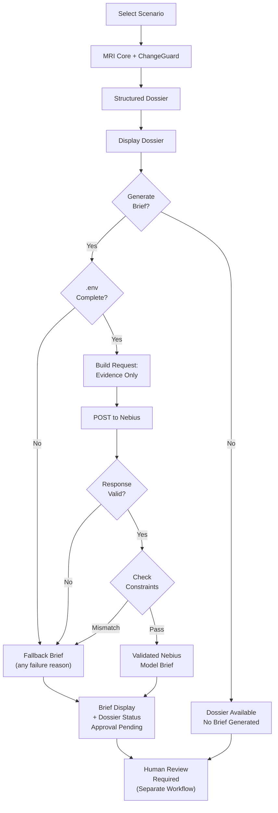
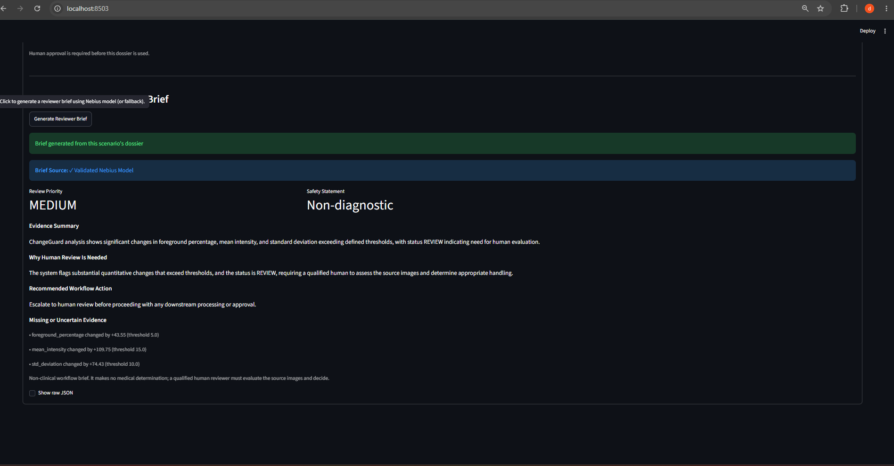

# MRI Evidence Council — Nebius × NVIDIA

## Overview

MRI Evidence Council is a non-diagnostic, evidence-grounded evidence-dossier layer built as part of the Nebius × NVIDIA hackathon initiative. It wraps the existing deterministic MRI Core pipeline and offers an optional, on-demand Nebius-powered reviewer brief generation for synthetic scenarios.

## Important Disclaimer

**This is NOT a diagnostic tool.** All outputs are evidence-grounded supporting analyses intended to assist human medical professionals in their review process. No clinical diagnosis or treatment recommendations are made by this system. A qualified radiologist or physician must review and validate all findings.

## Features

- **Deterministic Evidence Dossier**: Wraps MRI Core and ChangeGuard output without modification
- **Four Synthetic Scenarios**: Fully deterministic workflow validation and testing
- **Optional Nebius Integration**: Button-triggered reviewer brief generation (all four scenarios)
- **Fallback Mechanism**: Deterministic fallback brief if model unavailable or invalid
- **Checked Output**: Model replies are schema- and wording-checked, and the priority is checked against the dossier status (see "What is grounded"); the brief is a separate object and cannot modify status or approval
- **Non-Diagnostic**: Evidence-grounded workflow support only; no clinical claims

## Architecture

### Data Flow



### Walkthrough

1. **Scenario Selection**: User selects one of four deterministic synthetic scenarios in the Streamlit UI.

2. **Evidence Generation**: MRI Core (deterministic image processing) and ChangeGuard (baseline comparison) produce structured evidence and a dossier status (CONSISTENT, REVIEW, or UNCERTAIN).

3. **Dossier Display**: The evidence dossier (status, quality metrics, ChangeGuard deltas, review notes) is displayed independently. Approval state remains PENDING and is unchanged by the optional reviewer brief.

4. **Optional Brief Generation**: Only clicking "Generate Reviewer Brief" initiates the Nebius integration.

5. **Configuration Check**:
   - If `.env` is missing, incomplete, or invalid: Skip HTTP call, generate labeled "Deterministic Fallback" brief with reason `not_configured`.
   - If `.env` is complete: Proceed to model inference.

6. **Evidence Transmission**: Structured, deterministic evidence (status, metrics, deltas) is sent to NVIDIA Nemotron through Nebius Token Factory API. **Not sent:** image bytes, reviewer comments, approval state, or approval fields.

7. **Response Validation**:
   - **Transport failure** (network error, timeout, HTTP error): Fallback with labeled reason (`http_error: 404_endpoint`, `url_error: dns`, etc.).
   - **Invalid JSON or schema**: Fallback with labeled reason.
   - **Valid JSON**: Check deterministic constraints.

8. **Deterministic Constraint Checks** (Cannot be overridden by model):
   - `review_priority` must match dossier status mapping (CONSISTENT→LOW, REVIEW→MEDIUM, UNCERTAIN→HIGH). Mismatch: fallback.
   - `safety_statement` must exactly match fixed project text. Mismatch: fallback.
   - `missing_or_uncertain_evidence` is replaced with deterministically derived facts from dossier (ignored if model returns different list).

9. **Brief Display**:
   - **Validated Nebius Model**: Response passed all checks; model-authored `evidence_summary`, `why_human_review_is_needed`, `recommended_workflow_action` are displayed alongside deterministic safety statement and evidence list.
   - **Deterministic Fallback**: Labeled with reason; all fields derived from dossier, no model text.

10. **Human Approval**: Dossier remains PENDING. Human reviewer must make a named approval or rejection decision independently of the brief.

### Validation Scopes

**Deterministically Enforced** (application-controlled, model cannot override):
- Dossier status and approval state
- Review priority (mapped from status)
- Safety statement (fixed project text, not model-authored)
- Missing or uncertain evidence list (derived from dossier facts)

**Schema- and Wording-Checked** (model-authored, validated for safety but not fact-verified):
- Evidence summary, why human review is needed, recommended workflow action
- Checked for non-empty text, length, absence of diagnostic/clinical terminology, no approval tokens
- **Not checked**: Factual accuracy, numeric correctness, status-keyword consistency, claim verification

**Human Review Required**: All model-authored text must be verified against source images before clinical use.

## Running the Demo

### Terminal Demo

```bash
python -m hackathon.nebius_nvidia.demo
```

Outputs deterministic evidence dossiers and metrics for four synthetic scenarios.

## Synthetic Scenarios

The four scenarios are deterministic synthetic MRI workflow tests, not random data or clinical samples. Each scenario exercises a specific workflow path and validates evidence integrity.

1. **Consistent Baseline + Current** (`consistent_baseline_current`)
   - **Purpose**: Validate workflow for matching baseline and current evidence (no change detected)
   - **Image**: Identical synthetic disc (radius 30) for both current and baseline
   - **Expected Status**: CONSISTENT
   - **Outcome**: No ChangeGuard findings; low review priority. The dossier is displayed. If no brief is requested (button not clicked), the workflow stops here. If a brief is requested and succeeds, it will have priority LOW; if it fails (config/transport/validation), a deterministic fallback shows unchanged state

2. **Large Change Review** (`large_change_review`)
   - **Purpose**: Validate workflow for significant change detection requiring human review
   - **Image**: Current disc (radius 50) vs. baseline (radius 15); substantial foreground and intensity shift
   - **Expected Status**: REVIEW
   - **Outcome**: ChangeGuard detects changes exceeding thresholds; medium review priority; requires human evaluation before approval

3. **Low Information Uncertain** (`low_information_uncertain`)
   - **Purpose**: Validate workflow for low-contrast, unclear evidence (no baseline for comparison)
   - **Image**: Uniform low-contrast image (value 100), no baseline supplied
   - **Expected Status**: UNCERTAIN
   - **Outcome**: Quality flags triggered (low contrast, foreground nearly full); no ChangeGuard analysis; high review priority; human reviewer must assess sufficiency

4. **Reviewer Approval Gate** (`reviewer_approval`)
   - **Purpose**: Validate named-reviewer approval workflow and dossier immutability
   - **Image**: Same as "Large Change Review" (current radius 50 vs. baseline radius 15)
   - **Expected Status**: REVIEW (dossier status unchanged)
   - **Outcome**: Demonstrates that a named reviewer can make an approval decision, the dossier retains its PENDING state and REVIEW status unchanged, and the approval requirement is enforced

All scenarios produce deterministic dossiers with status, quality metrics, ChangeGuard findings (where applicable), and review notes. The optional Nebius brief overlays model-authored prose on this deterministic foundation; the brief is validated against the dossier facts and discarded (fallback) if it violates the grounding constraints.

### Streamlit UI (with optional Nebius integration)

```bash
# run from the repository root
python -m streamlit run hackathon/nebius_nvidia/streamlit_app.py
```

Opens an interactive UI showing all four scenarios with their dossier evidence. Each scenario includes an optional "Generate Reviewer Brief" button that:
- **Without Nebius config**: Shows a deterministic fallback brief derived from that scenario's dossier
- **With Nebius config**: Attempts model inference; falls back to deterministic brief on any failure

## Nebius Integration

### Optional Configuration (Streamlit Mode)

The Nebius model integration is optional and runs in **local `.env`-only mode**. This means:

- Configuration is read **only** from `.env` at the repository root
- Process environment variables (inherited or machine-level) are **never** checked or used
- This isolation prevents accidental credential leakage from CI/CD systems or shared machines

To enable Nebius integration, create or edit `.env` in the repository root and set:

```
NEBIUS_API_KEY=<your-api-key>
NEBIUS_BASE_URL=<base URL ending at the API root, e.g. .../v1; the app appends /chat/completions>
NEBIUS_MODEL=<exact model ID from your Nebius dashboard>
```

`.env` is git-ignored. Never commit it or paste its contents anywhere.

**Important:** This Streamlit mode enforces strict `.env`-only configuration. For hosted deployments (cloud platforms, Docker, Kubernetes), a separately reviewed secret-injection approach would be required to inject credentials at runtime without modifying the codebase.

### Brief Generation

When the "Generate Reviewer Brief" button is clicked:

1. Structured synthetic dossier evidence (status, quality metrics, ChangeGuard status/deltas, review notes) is sent to Nebius, with `max_tokens=4096`
2. A JSON brief is returned and checked (see below)
3. The brief source is marked as either "Validated Nebius Model" or "Deterministic Fallback"
4. The brief is displayed with a fixed, project-authored safety statement

**Live example** (Scenario 4, configured Nebius model):



The screenshot shows:
- ✓ Validated Nebius Model source badge
- Review Priority: MEDIUM (deterministically mapped from REVIEW status)
- Safety Statement: Non-diagnostic (fixed project text, not model-authored)
- Evidence Summary: Model-authored analysis of dossier status and metrics
- Why Human Review Is Needed: Model-authored context
- Recommended Workflow Action: Model-authored routing guidance
- Missing or Uncertain Evidence: Deterministically extracted from dossier facts (quality flags, ChangeGuard deltas)

**The Nebius model cannot:**
- Change the dossier status or approval state
- Receive image bytes, reviewer comments, or approval fields
- Modify human approval requirements

### What is grounded versus only schema-checked

Grounded in dossier facts (unchanged by model, deterministically enforced):
- `review_priority` must equal the deterministic mapping from dossier status (CONSISTENT→LOW, REVIEW→MEDIUM, UNCERTAIN→HIGH); a mismatch triggers the deterministic fallback (`validation_failed: priority_mismatch`).
- `safety_statement` must exactly match the fixed project-authored statement: "Non-clinical workflow brief. It makes no medical determination; a qualified human reviewer must evaluate the source images and decide." Any variation (paraphrase, edit, clinical language) triggers the fallback (`validation_failed: safety_statement must be exact`).
- `missing_or_uncertain_evidence` is built from dossier facts (quality flags, ChangeGuard reasons, or "No baseline comparison available" only when no baseline exists). The model's list is not displayed; the brief always shows the deterministic list.
- The dossier status and human-approval requirement never change; the brief is a separate, immutable object.

Only schema- or wording-checked (not verified against dossier facts or images):
- `evidence_summary`, `why_human_review_is_needed`, and `recommended_workflow_action` are model-written. They are checked for non-empty text, length, a diagnostic-wording filter, and the absence of literal approval tokens, but **not** for factual accuracy, correct numbers, status-keyword consistency, or baseline-comparison claims.
- A human reviewer must verify all model-authored text against the source images before any clinical use.

### Fallback Mechanism

If Nebius is not configured, configured incorrectly, or returns invalid data:
- A deterministic fallback brief is generated from dossier fields
- The brief source is marked as "Deterministic Fallback"
- The fallback reason is a fixed category, never raw error text: `not_configured`, `validation_failed: ...`, `http_error: <status>_<label>`, `url_error: <dns|tls_certificate|proxy|timeout|connection|unknown>`, or `transport_stage: <request_build|request_send|response_decode|response_null_content>`. A null-content reason adds only enum metadata (finish reason, content null/empty/absent, reasoning present yes/no, output-token count)

## Testing

### Run Focused Tests

```bash
pytest tests/test_nebius_local_env.py tests/test_nebius_streamlit_app.py tests/test_nebius_nemotron_review.py -q
```

Tests cover:
- Environment variable loading (.env file and process env)
- Button interaction and brief generation in the Streamlit app
- Streamlit path reads only the repository-root `.env`; inherited process variables are ignored
- Request construction, error categories, and the grounding checks above (all mocked; no network)

## Implementation Notes

- **Synthetic data only**: All scenarios use deterministic synthetic MRI images and metrics
- **Live-tested (Scenario 4)**: The Streamlit button has generated a Nebius-validated brief for Scenario 4 with a configured API key. The screenshot above is the result. This is a single observation under specific configuration, not a comprehensive evaluation of model accuracy, reliability, or generalization to real images. The model successfully returned a valid JSON brief with correct priority mapping and exact safety-statement matching.
- **Automated tests only, no live calls**: All 128 test cases use mocked Nebius responses; no live API calls are made in the test suite. Tests verify validation logic, fallback behavior, config isolation, and grounding checks.
- **Safe by design**:
  - Named human approval is always required; the model cannot change dossier status or approval state
  - Model-authored text fields are checked for forbidden medical/clinical wording
  - Safety statement is fixed project text, never substituted with model output
  - All validation failures safely trigger deterministic fallback
- **Offline-safe**: Full functionality available without network or Nebius credentials; fallback works for any reason (not configured, network error, invalid response, validation failure)

## Live Nebius Integration: Challenges and Lessons

### Observed Issues

During live testing with the NVIDIA Nemotron model via Nebius Token Factory, several validation failures were observed:

1. **Insufficient Output Budget**: Early configuration used `max_tokens=160`, which was insufficient for generating complete, usable responses. Some model outputs were truncated (finish reason: `length`), yielding no usable content or null/empty message fields.

2. **Priority Mismatch**: Some model responses chose a review priority that did not match the deterministic mapping from the dossier status (e.g., returned "HIGH" when the status mapping required "MEDIUM").

3. **Safety Statement Validation**: Model responses included paraphrases or variations of the project-authored safety statement instead of copying the exact text, triggering fallback with reason `validation_failed: safety_statement must be exact`.

### Implemented Solutions

1. **Increased Output Limit**: Raised `max_tokens` from 160 to 4096. With 160 tokens, live testing observed truncated responses with finish reason `length`. This change provides substantially more budget for brief generation.

2. **Request Timeout**: Set reviewer-brief HTTP timeout to 90 seconds to accommodate network latency and model processing time. Timeout errors trigger deterministic fallback without modifying the dossier.

3. **Deterministic Priority Enforcement**: The system prompt now explicitly instructs the model to copy the required priority from the user message (`REQUIRED_REVIEW_PRIORITY`) using the fixed mapping (CONSISTENT→LOW, REVIEW→MEDIUM, UNCERTAIN→HIGH). Responses with mismatched priority still trigger fallback; validation is not relaxed.

4. **Exact Safety Statement Matching**: The system prompt and user message now supply the exact project-authored safety statement (`REQUIRED_SAFETY_STATEMENT`). Validation rejects any variation (paraphrase, edit, clinical language), triggering labeled fallback (`validation_failed: safety_statement must be exact`).

5. **Comprehensive Fallback**: All validation failures—transport errors, invalid JSON, schema violations, priority mismatch, safety statement mismatch, timeout—produce a labeled, deterministic fallback brief without modifying the dossier or approval state.

### Model Migration and Reliability

**Current Model:** The reviewer brief uses `nvidia/Nemotron-3_5-Lightning` via Nebius Token Factory.

**Prior Model:** The previous model `nvidia/NVIDIA-Nemotron-3-Nano-30B-A3B` was scheduled for retirement and has been migrated to maintain service continuity.

**Configuration and Limits:**
- Completion token limit: 4,096 tokens per request
- HTTP request timeout: 90 seconds
- Response is mandatory JSON object with fixed schema; invalid/empty responses trigger fallback

**Reliability:** The reviewer brief is accepted only after structured-output validation. If the configured model is unavailable, times out, returns invalid or empty content, or fails schema validation, the app uses the deterministic fallback brief. The dossier status and human-approval requirement (`PENDING_HUMAN_APPROVAL`) are never changed by the model response.

### Limitations and Requirements

- **Model-Authored Text Not Independently Fact-Verified**: The fields `evidence_summary`, `why_human_review_is_needed`, and `recommended_workflow_action` are model-written. They are checked for non-empty text, length, and diagnostic-wording safety, but **not** independently verified for factual accuracy, correct numbers, or status-keyword consistency. A qualified human reviewer must verify all model-authored text against source images before any clinical use.

- **No Clinical Validation**: The system does not perform clinical validation of the model output. The live test on Scenario 4 was a single observation under specific configuration and does not constitute a reliability evaluation, accuracy assessment, or clinical validation. This is a non-diagnostic workflow support tool.

- **Synthetic Workflow Testing Only**: All four scenarios use deterministic synthetic data and synthetic workflow validation metrics. Results establish that the system handles the expected workflow paths and enforces the grounding constraints; they do not validate the model's performance on real images or clinical data.
