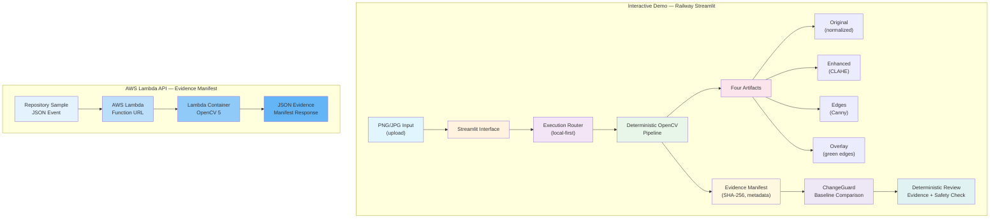

# MRI Vision Core — Deterministic OpenCV Evidence Workflow

A deterministic, research-and-education OpenCV image-processing workflow for exploring MRI slice structure. This is a **non-diagnostic** demonstration and does not provide clinical interpretation.

## Live Demonstrations

**Railway Streamlit Interactive Demo:**
https://mri-vision-core-production-6dfd.up.railway.app

**AWS Lambda API Endpoint (Evidence Manifest):**
https://gpint2fywbzbcy5crjldc2j6oi0pmxyb.lambda-url.us-east-1.on.aws/

## Architecture



## Included Synthetic Walkthrough Input

The repository includes `synthetic_knee_mri_phantom_1.png` as the reproducible input for the OpenCV walkthrough. It is a synthetic demonstration image, not patient data, and is not intended for clinical use.

[Open the included synthetic walkthrough input](../../sample_data/opencv_aws/synthetic_knee_mri_phantom_1.png)

## How It Works — Live Walkthrough

1. **Load an image**: Download and upload the included synthetic demonstration image, `synthetic_knee_mri_phantom_1.png`, or upload another PNG/JPG supplied by the user.
2. **Run OpenCV processing**: Click "Run OpenCV Processing"
   - Normalizes grayscale to [0–255]
   - Applies CLAHE contrast enhancement (clipLimit=2.0, 8×8 tiles)
   - Detects edges with Gaussian blur + Canny (thresholds 40, 120)
   - Overlays green edges on the enhanced base
3. **Review outputs**: Four visual artifacts in a 2×2 grid
4. **Compare with baseline** (ChangeGuard):
   - Run again to store and compare against the enhanced output
   - Foreground delta: % of pixels changing ≥10 intensity counts
   - Mean intensity delta: absolute difference in pixel means
   - **STABLE** if both below thresholds (≥15%, ≥20 counts)
   - **REVIEW** if thresholds exceeded
5. **Run evidence review**:
   - Click "Run Agentic Evidence Review"
   - See three deterministic agent summaries (Evidence Specialist, Safety Critic, Consensus Coordinator)
   - Final decision: `NO_ACTION`, `REQUEST_MORE_EVIDENCE`, or `PENDING_HUMAN_APPROVAL`
6. **Inspect evidence manifest**: View SHA-256, processing steps, and artifact names

## Verification

**Deterministic OpenCV test suite:**
```bash
pytest tests/test_opencv_mri.py -v
```
All processing is pixel-deterministic: identical input always produces identical output, SHA-256, and processing metadata.

**Torch-optional regression test (Railway deployment fix):**
```bash
pytest tests/test_streamlit_app_torch_free.py -v
```
The fresh-process Torch-optional regression test blocks `torch` and verifies that a Torch import does not prevent application startup. It specifically guards against the prior Railway `ModuleNotFoundError: No module named 'torch'`; it does not assert successful startup when other required dependencies are absent.

**Evidence review tests:**
Deterministic review agent tests in `tests/test_opencv_review_agents.py` verify:
- Evidence Specialist correctly summarizes manifest and ChangeGuard facts
- Safety Critic detects missing evidence and forbids diagnostic language
- Consensus Coordinator returns correct final decision for each scenario
- All decisions are deterministic (same input always produces same output)

## AWS and Deployment

### Railway Streamlit — Interactive Visual Demo
**Status:** Live and running
**URL:** https://mri-vision-core-production-6dfd.up.railway.app

The Railway Streamlit app provides the interactive visual demonstration of the complete deterministic workflow:
- Local OpenCV processing (no ML model)
- ChangeGuard baseline comparison (deterministic thresholds)
- Agentic evidence review (three deterministic roles, mandatory human gate)

### AWS Lambda — Live Deployed API
**Status:** Deployed and tested
**Function URL:** https://gpint2fywbzbcy5crjldc2j6oi0pmxyb.lambda-url.us-east-1.on.aws/

The AWS Lambda Function URL provides a live, deployed evidence-manifest API that accepts JSON POST requests and returns deterministic evidence manifests.

**Sample Payload:** The Lambda accepts the documented sample JSON event from the repository. On October 23, 2026, a POST request using the repository sample event—not patient data—to the deployed AWS Function URL returned HTTP 200 with an evidence manifest.

**Handler:** `hackathon/opencv_aws/evidence_manifest.py::lambda_handler`

The repository includes:
- SAM template (`template.yaml`) for AWS Lambda deployment
- Lambda-ready Dockerfile (python:3.12 headless) for containerized invocation
- Evidence manifest capture logic with HTTP Function URL support
- Deterministic OpenCV 5 processing in the Lambda container
- Full test coverage with captured invocation evidence

## AWS Deployment Evidence


## Data and License

Any future MIT license applies to project-authored source code only. External datasets, images, and model assets remain governed by their original terms.

## Limitations

This workflow is **not a medical device** and has no clinical purpose. Specifically:
- **No diagnosis**: No diagnostic claims are made or permitted
- **No clinical interpretation**: The outputs are image-processing artifacts, not medical findings
- **No clinical performance claim**: No clinical validation, sensitivity, specificity, or predictive accuracy
- **Evidence is research only**: Deterministic workflow evidence documents processing, not medical truth

Use for education and research only.

---

**MRI Vision Core — A Deterministic, Research-Grade OpenCV Demonstration**
